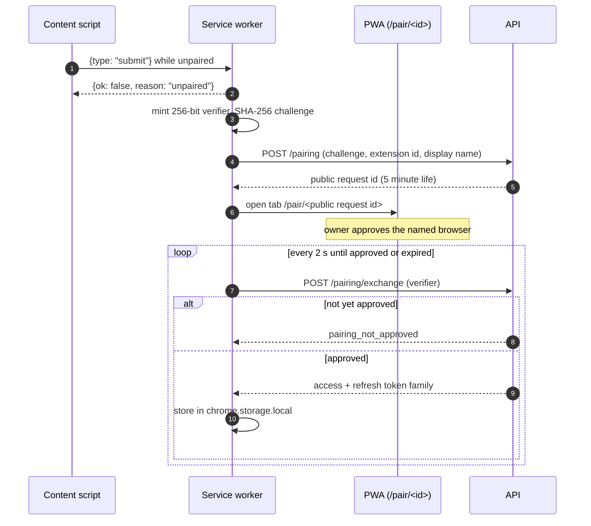

# Chromium extension: structure, messages, pairing, and packaging

Design draft for [#24](https://github.com/MAX-786/visual-youtube-notes/issues/24). The decisions and
their rationale live in
[ADR 0013](../adr/0013-chromium-extension-structure-and-pairing.md); this file is the mechanical
detail. The manifest draft is [`extension-manifest.json`](extension-manifest.json), checked by
[`extension-manifest.test.mjs`](extension-manifest.test.mjs).

Related: [ADR 0003](../adr/0003-owner-auth-device-sessions-and-extension-pairing.md) owns Pairing,
CORS and the token family; [ADR 0012](../adr/0012-pwa-shell-live-updates-and-offline-cache.md) owns
the PWA side, including the `/pair/[requestId]` approval route.

## Identity

| Fact               | Value                                                                          |
| ------------------ | ------------------------------------------------------------------------------ |
| Extension ID       | `fjodmlmkfifedoamachdbgigfpaldicm`                                             |
| Allowlisted origin | `chrome-extension://fjodmlmkfifedoamachdbgigfpaldicm`                          |
| Pinned by          | `key` in the manifest (base64 public key)                                      |
| Private key        | `deploy/secrets/extension_signing_key.pem`, gitignored, developer machine only |

The ID is derived from the key: SHA-256 of the DER public key, first 16 bytes, hex, each nibble
mapped `0-f` onto `a-p`. The manifest test re-derives it and asserts it satisfies
`device_sessions.extension_id`'s `^[a-p]{32}$` constraint.

## File layout

```
extension/
  src/
    service-worker.ts     API calls, tokens, refresh lock, pairing
    content-script.ts     button injection, toast, no credentials
    content-script.css
    popup.ts              pairing status, sign out
    popup.html
    lib/
      video-id.ts         URL -> video ID, shared with the tests
      anchor.ts           where the button attaches, and the fallback
      messages.ts         the discriminated union below
  icons/
  build.mjs               esbuild: three entries, manifest copy, zip
  tests/                  vitest over lib/, plus the DOM fixture
```

Three bundles, because Manifest V3 loads three independent contexts. `lib/` is shared source, not a
runtime module.

## Message protocol

One-shot `chrome.runtime.sendMessage`, request/response, no long-lived port — the service worker is
ephemeral and a port would only pin it open.

```ts
type Request =
  | { type: "submit"; videoId: string } // videoId is a claim, not an instruction
  | { type: "undo"; submissionId: string }
  | { type: "status" } // popup asks for pairing state
  | { type: "pair" }
  | { type: "sign-out" };

type Response =
  | { ok: true; outcome: "created"; submissionId: string; noteUrl: string }
  | { ok: true; outcome: "duplicate"; noteUrl: string }
  | { ok: true; outcome: "held"; noteUrl: string }
  | {
      ok: false;
      reason: "unpaired" | "video_id_mismatch" | "offline" | "rejected";
      detail?: string;
    };
```

**The service worker derives the video ID from `sender.url`**, not from `videoId`. The claim is
compared to the derived value and a mismatch returns `video_id_mismatch` without submitting. See
ADR 0013 for why both exist.

`sender.url` is browser-populated and needs no `tabs` permission. Whether it tracks History API
navigation promptly on YouTube is **unverified** — the mismatch guard is what makes that safe to
find out.

## The in-page action

### Attaching

```
yt-navigate-finish  ──┐
MutationObserver    ──┼──> re-resolve video ID from location ──> ensure button
(backstop)            │
initial document_idle ┘
```

YouTube never reloads between videos, so attachment is re-run on navigation and the video ID is
re-read every time rather than captured once.

Anchor resolution, in order:

1. The watch-page actions row, so the button sits with Like and Share.
2. **Fallback: a floating overlay anchored to the player.**

The fallback exists because YouTube's internal element IDs are renamed without notice. A selector
that degrades to a working overlay is worth more than one that degrades to no entry point at all.

### Toast states

| Outcome              | Toast                                  | Undo     |
| -------------------- | -------------------------------------- | -------- |
| `created`            | "Added to Visual Notes"                | yes, 5 s |
| `duplicate`          | "Already saved — Open note"            | no       |
| `held`               | "Saved — needs your cost confirmation" | no       |
| `unpaired`           | "Pair this browser" -> opens pairing   | no       |
| `video_id_mismatch`  | "Page changed — try again"             | no       |
| `offline`/`rejected` | the server's reason, verbatim          | no       |

The toast owns the countdown. The popup mirrors it while open. Closing the tab inside the five
seconds lets the job run — Undo is best-effort against a delayed River job, not a transaction.

## Pairing



Polling the exchange endpoint means approval-checking needs no new endpoint and no new CORS entry —
ADR 0003 already allows exchange. `externally_connectable` is deliberately absent from the manifest.

The display name distinguishes browsers sharing one extension ID: read
`navigator.userAgentData.brands` for Edge and Chrome, `navigator.brave` for Brave, falling back to
"Chromium browser". It is only a label; `device_sessions.display_name` caps it at 80 characters.

Clicking the in-page button while unpaired **or expired** starts this same flow and opens the
approval tab. There is one unpaired state, not two, and no reliance on
`chrome.action.openPopup()`.

## Tokens

- `chrome.storage.local` only. Never `storage.sync` — syncing replicates the token family to every
  machine on the Google account, defeating the Device-session boundary.
- Every refresh runs under a `navigator.locks` lock in the service worker, re-reading the stored
  token inside the lock. ADR 0003 revokes the session on refresh reuse with no grace window, so two
  concurrent refreshes would revoke the extension.
- A `401` surviving one refresh attempt clears storage and drops to unpaired.
- Explicit sign-out calls the extension-logout endpoint first, then clears locally, so server and
  local state cannot drift.

## Build and packaging

`build.mjs` runs esbuild over three entry points (ES2022, bundled, unminified), copies the manifest
and icons, and emits `dist/` plus a zip. `pnpm build` runs it, so CI compiles what ships rather than
only typechecking it.

Vite is rejected here: no dev server or HMR applies to an extension, and three fixed entry points do
not need a plugin pipeline. `@crxjs/vite-plugin` is rejected as a third-party dependency on the
critical path of a build that has to keep working for years.

### Loading it

Same `dist/` in all three browsers, developer mode enabled:

| Browser | Path                                                     |
| ------- | -------------------------------------------------------- |
| Chrome  | `chrome://extensions` -> Developer mode -> Load unpacked |
| Edge    | `edge://extensions` -> Developer mode -> Load unpacked   |
| Brave   | `brave://extensions` -> Developer mode -> Load unpacked  |

The `key` makes all three report ID `fjodmlmkfifedoamachdbgigfpaldicm`. If one reports a different
ID, the manifest lost its `key` — that is the first thing to check, because the server will reject
the origin.

## Verification

Unit tests (vitest) over `lib/`:

- Video-ID extraction across every URL form spec 8.1 accepts: `youtube.com/watch?v=`,
  `m.youtube.com`, `youtu.be/`, `/shorts/`, `/live/`, `/embed/`, playlist URLs carrying `v`, and
  rejection of non-YouTube and malformed input.
- Anchor resolution against a captured watch-page DOM fixture, including the overlay fallback when
  the actions row is absent.

There is no CI test against live YouTube: it would fail on a YouTube redesign, which is red for a
reason unrelated to the change.

### Browser checklist (spec 16 acceptance)

Run per browser after any manifest change:

1. Extension ID reads `fjodmlmkfifedoamachdbgigfpaldicm`.
2. Pairing completes; Settings lists the new Device session with the right browser name.
3. In-page button appears on a `/watch` page and on a `/shorts` page.
4. **Navigate watch -> watch without reloading**, then submit: the note created matches the video on
   screen. This is the `sender.url` check ADR 0013 leaves open.
5. Undo inside five seconds removes the note; after five seconds it does not.
6. A duplicate opens the existing note and creates no second row.
7. Revoking the session from PWA Settings drops the extension to unpaired on its next submit.

## Follow-on work this leaves open

- The OpenAPI contract for `/pairing`, `/pairing/exchange`, `/submissions` and extension logout, which
  the OpenAPI ticket will fix alongside every other resource. The outcomes this design renders
  (`created`, `duplicate`, `held`) must appear in that schema.
- Rate limits on job creation, still unspecified on the map.
- Icon assets, which are production artwork rather than a decision.
