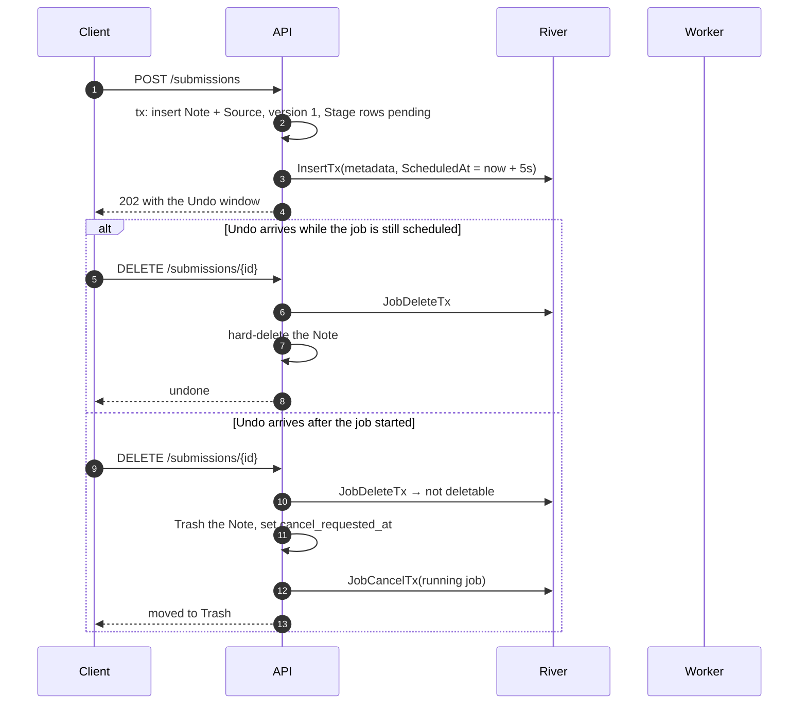
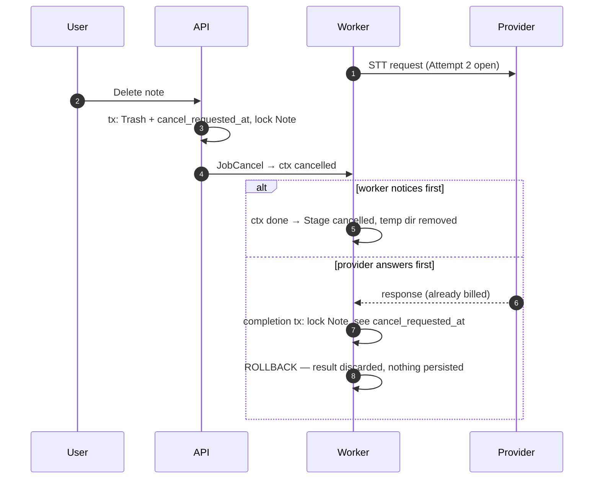

# Pipeline: Stages, Attempts, cancellation, and cleanup

Design draft for [#18](https://github.com/MAX-786/visual-youtube-notes/issues/18). Decisions and
rationale live in [ADR 0006](../adr/0006-pipeline-stages-as-chained-river-jobs.md); this file is
the mechanical detail. Schema:
[`000005_pipeline_stages.up.sql`](../../deploy/migrations/000005_pipeline_stages.up.sql).
River capabilities and their limits were established in
[#5](https://github.com/MAX-786/visual-youtube-notes/issues/5).

## Jobs and queues

| Job kind       | Queue     | `MaxWorkers` | `JobTimeout` | Work                                                     |
| -------------- | --------- | ------------ | ------------ | -------------------------------------------------------- |
| `metadata`     | `default` | 2            | 60 s         | `yt-dlp -J`, eligibility, Source row                     |
| `captions`     | `default` | 2            | 2 min        | fetch track, parse, usability test, normalize Transcript |
| `transcribing` | `media`   | 1            | 45 min       | audio download, FFmpeg split, STT, overlap removal       |
| `generating`   | `default` | 2            | 5 min        | note model call, validation, repair, Revision            |
| `indexing`     | `default` | 2            | 10 min       | children, embeddings, then `ready`                       |
| `regenerate`   | `default` | 2            | 5 min        | reuses `generating` then `indexing`                      |

`MaxAttempts: 4` everywhere — one try plus three retries. `RescueStuckJobsAfter` is
`JobTimeout + 5m`, not River's 1-hour default, which would blow every target in section 15 after a
crash.

`NextRetry` override, per the #5 research (`job.Attempt` is already incremented for the run that
just failed):

```go
func (w *stageWorker) NextRetry(job *river.Job[StageArgs]) time.Time {
    delays := []time.Duration{30 * time.Second, 2 * time.Minute, 10 * time.Minute}
    i := min(max(job.Attempt-1, 0), len(delays)-1)
    return time.Now().Add(delays[i])
}
```

A 30-second retry lands at 30–35 s: River's scheduler polls every 5 s.

## The shape of a Stage worker

Every Stage worker is the same seven steps. Only the middle one differs.

1. **Entry guard.** Read the Note and its Stage row. If `cancel_requested_at` is set, mark the
   Stage `cancelled` and return `JobCancel`. If the Stage is already `ready`, return nil — this is
   a duplicate delivery.
2. **Open the Stage** — `status = running`, `started_at = now()`, `river_job_id`.
3. **Open an Attempt** — a `stage_attempts` row with the next `attempt_no` and the idempotency key
   about to be sent. Committed _before_ the external call, so a crash leaves evidence.
4. **Do the work**, honouring `ctx` so cancellation aborts the in-flight request.
5. **Close the Attempt** with its fingerprint: provider request id, SHA-256 of the response body,
   byte size. On failure, the error code and `is_permanent`.
6. **Completion transaction** — lock the Note `FOR UPDATE`, re-check `cancel_requested_at`, write
   the Stage `ready`, write the domain rows, append the `sync_events` row, and `JobCompleteTx` the
   current job while inserting the next Stage's job. All or nothing.
7. **Cleanup** the Attempt's temporary directory.

Step 6 is where the chaining race is settled: the lock makes check-and-enqueue atomic against a
concurrent Delete, so a late result is discarded by the transaction rolling back.

## Error classification

One function, `classify(stage, err) → transient | permanent`, is the only place this is decided.

| Signal                                                          | Verdict                          |
| --------------------------------------------------------------- | -------------------------------- |
| Network error, timeout, context deadline                        | transient                        |
| Provider 429, any 5xx                                           | transient                        |
| Provider 408, 409                                               | transient                        |
| Any other provider 4xx                                          | permanent                        |
| Schema, grounding, or diagram validation failure                | permanent                        |
| `yt-dlp` stderr with the "please report this issue" suffix      | transient (extractor breakage)   |
| `yt-dlp` stderr matching "Unable to download webpage\|API page" | transient (network)              |
| Any other `yt-dlp` `ERROR:`                                     | permanent (legitimate rejection) |

`yt-dlp` exits 1 for all three cases, so stderr is the only discriminator — established in
[#4](https://github.com/MAX-786/visual-youtube-notes/issues/4).

Both failure routes converge on one `failStage()` helper:

```go
if verdict == permanent {
    failStage(ctx, tx, stage, err, /* permanent */ true)   // writes Stage, Note, sync event
    return river.JobCancel(err)
}
if job.Attempt >= job.MaxAttempts {                        // exhaustion: River discards after we return
    failStage(ctx, tx, stage, err, /* permanent */ false)
}
return err
```

Without the second branch a Note whose Stage exhausts its ladder would sit in a processing state
forever while River silently discards the job.

## Submission, Undo, and Delete



Undo is defined by the job's state, not by the clock. River promotes scheduled jobs on a 5-second
poll, so work actually begins between 5 and 10 seconds in — the client's countdown and the server's
real deadline are different things, and the server never trusts the countdown. `JobDeleteTx`
failing because the job has started _is_ the signal to take the Delete path.

## Cancellation mid-Stage



The billed call is an accepted at-least-once boundary (section 8.4). What the design guarantees is
that a cancelled run never _persists_ a late result and never enqueues the next Stage.

## Temporary directories

```
/var/tmp/vyn/<note_id>/<processing_version>/<stage>/<attempt_id>/
```

Cleanup runs three ways, per section 15: after every job (success, failure, or cancellation), at
worker startup, and hourly.

The sweep removes directories older than six hours whose Attempt is **not active**. Active cannot
simply mean an unfinished `stage_attempts` row — after a hard crash that row never finishes and the
directory would leak forever. `stage_attempts_collectable` therefore defines collectable as
_finished, or belonging to a Stage in a terminal state_, and the stale-attempt reaper guarantees
the second condition eventually holds. The view is deliberately independent of `river_job`, which
River prunes.

Because Q4's Retry bumps `processing_version`, a retried run writes into a new directory —
"never reuses temporary media" is structural rather than a deletion someone must remember.

## Periodic jobs

River's `PeriodicJobs` are leader-elected, so each runs on exactly one worker.

| Job                  | Cadence | Work                                                        |
| -------------------- | ------- | ----------------------------------------------------------- |
| Trash purge          | hourly  | delete Notes past `purge_after` and their dependent rows    |
| Temp sweep           | hourly  | remove collectable directories older than six hours         |
| Stale-attempt reaper | 15 min  | close `stage_attempts` whose Stage reached a terminal state |
| Retention prune      | daily   | `sync_events` and `note_mutations` past 30 days (from #16)  |

The reaper is what stops the Stage table slowly lying about what is running, and it is the
precondition that makes the temp sweep's "active" test terminate.

## Sync events

Emitted on user-visible Stage transitions and terminal outcomes only — the seven Stages plus
`failed` and `cancelled`, roughly eight per Note. Written in the same transaction as the Stage row,
so a client resyncing by cursor sees a consistent history.

Retries inside a Stage emit nothing. Section 8.4 promises the UI shows the failed Stage, not a live
attempt counter, and a card flickering through four identical "captions" events communicates
anxiety rather than information.

SSE is fed from `sync_events`, never from River's `Client.Subscribe`, which is in-process only and
cannot reach the API process.

## Follow-on work this leaves open

- **Concurrency thresholds.** Section 13 wants FFmpeg/STT serialization to engage "when CPU or disk
  pressure crosses configured thresholds." The _mechanism_ is decided here — a `media` queue at
  `MaxWorkers: 1` — but the thresholds need measurements on the OCI host and remain fog on the map.
- **River's own migrations** must run alongside ours; ordering belongs to
  [#20](https://github.com/MAX-786/visual-youtube-notes/issues/20).
- **The spec sentence in 8.4** should be corrected to say three automatic _retries_, so the next
  reader does not re-derive the ambiguity.
