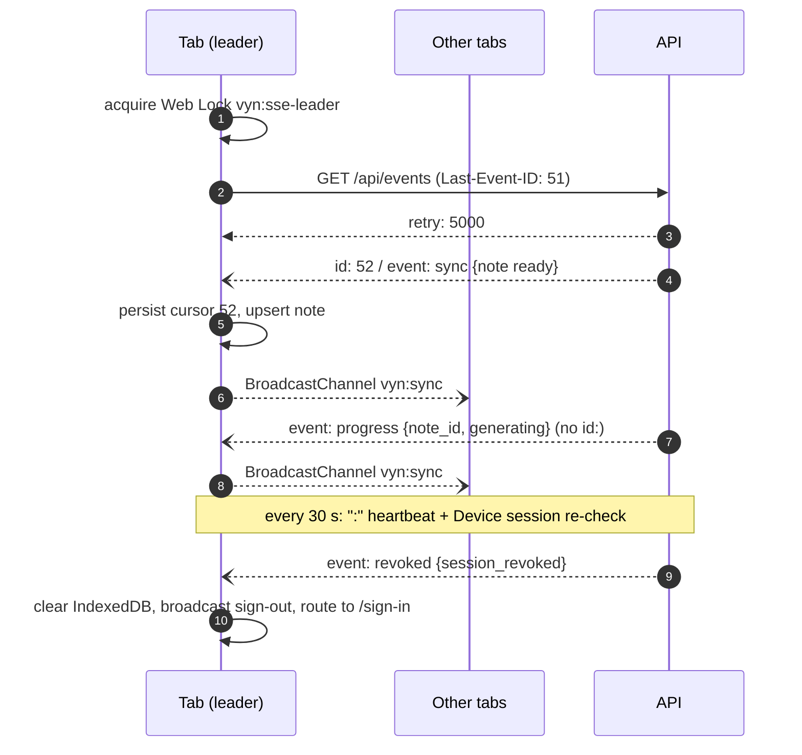

# PWA shell: routes, cache, live updates, and the share handler

Design draft for [#23](https://github.com/MAX-786/visual-youtube-notes/issues/23). The decisions and
their rationale live in
[ADR 0012](../adr/0012-pwa-shell-live-updates-and-offline-cache.md); this file is the mechanical
detail — the route map, wire shapes, object stores, and the sequences.

Related: [`mutation-protocol.md`](mutation-protocol.md) owns the mutation envelope and the rebase
rule; [ADR 0003](../adr/0003-owner-auth-device-sessions-and-extension-pairing.md) owns cookies, CSRF
and pairing; [ADR 0008](../adr/0008-deployment-topology.md) owns the Caddy edge and the SSE
heartbeat.

## Route map

SvelteKit with `adapter-static`, `ssr = false`, `prerender = false`. Two layout groups: `(auth)` is
reachable signed out, `(app)` sits behind the session gate.

| Route               | Destination (spec 6) | Group    | Notes                                                                    |
| ------------------- | -------------------- | -------- | ------------------------------------------------------------------------ |
| `/sign-in`          | —                    | `(auth)` | Password login. Redirects to the pending intent, if any.                 |
| `/share`            | —                    | `(auth)` | `share_target` action. Reachable signed out so a share is never lost.    |
| `/`                 | 1 Today              | `(app)`  | Date-grouped feed and processing cards.                                  |
| `/library`          | 2 Library/Search     | `(app)`  | Query and filters in the URL, so a search is linkable and restorable.    |
| `/topics`           | 3 Topics             | `(app)`  | Primary topics and tag discovery.                                        |
| `/topics/[slug]`    | 3 Topics             | `(app)`  | One primary topic.                                                       |
| `/notes/[id]`       | 4 Note detail/editor | `(app)`  | Note canvas, versions, export. Transcript is a nested disclosure.        |
| `/settings`         | 5 Settings           | `(app)`  | Index; sections below are siblings, not tabs, so each is linkable.       |
| `/settings/account` | 5 Settings           | `(app)`  | Password, sessions, sign out everywhere.                                 |
| `/settings/ai`      | 5 Settings           | `(app)`  | Roles, models, `request_options`, key entry and verification.            |
| `/settings/usage`   | 5 Settings           | `(app)`  | Per-note and monthly spend, soft cap, held Notes.                        |
| `/settings/health`  | 5 Settings           | `(app)`  | Every `system_health` row, drill log, library archive download.          |
| `/trash`            | 6 Trash              | `(app)`  | Restore and purge.                                                       |
| `/pair/[requestId]` | —                    | `(app)`  | Extension pairing approval. Two segments — needs the fallback fix below. |

Processing status appears on Today and on note cards; there is deliberately no jobs screen
(spec 6).

### The fallback document

`svelte.config.js` sets `adapter({ fallback: "200.html" })`, so Caddy must serve **`/200.html`**, not
`/index.html`. The two files differ: a prerendered page carries relative asset URLs and a computed
`base`, the fallback carries absolute ones and `base: ""`. Serving `index.html` at `/notes/<id>`
resolves assets to `/notes/_app/...`, which `try_files` then answers with the HTML document itself
under a 200 status — a module-script MIME error, not a 404.

[`spa-fallback.test.mjs`](spa-fallback.test.mjs) asserts the Caddyfile and the adapter name the same
file, and that the root layout does not re-enable prerendering.

## Live updates

### The stream

`GET /api/events`, same-origin `EventSource`, cookie-authenticated. One stream per browser profile:
tabs contend for the Web Lock `vyn:sse-leader`, and the holder rebroadcasts every frame on the
`BroadcastChannel` `vyn:sync`.

| Frame             | `id:`       | Payload                                                                       | Durable |
| ----------------- | ----------- | ----------------------------------------------------------------------------- | ------- |
| `event: sync`     | the cursor  | `{cursor, entity_kind, entity_id, note_id, change, origin_device_session_id}` | yes     |
| `event: progress` | **omitted** | `{note_id, processing_state, stage_kind, stage_status, attempt}`              | no      |
| `event: resync`   | omitted     | `{reason: "cursor_expired"}`                                                  | —       |
| `event: revoked`  | omitted     | `{reason}`                                                                    | —       |
| `:` comment       | —           | heartbeat, every 30 s (ADR 0008)                                              | —       |

`sync` payloads are a `sync_events` row verbatim; `entity_kind` and `change` are the existing
`sync_entity_kind` and `sync_change` enums. A frame whose `origin_device_session_id` matches this
device is an echo of its own write and is dropped after the cursor is advanced.

The server sends `retry: 5000` once on connect, re-verifies the Device session on every heartbeat,
and closes with `revoked` when it is gone.

**`progress` frames must never carry an `id:` line.** `id:` populates `Last-Event-ID`, so a cursor
value there would be replaced by something that is not a cursor and the next reconnect would resume
from garbage.

### Polling fallback

`EventSource` reconnects on its own. After **three consecutive connect failures** the leader tears it
down and polls, re-attempting SSE every 5 minutes.

- `GET /api/events/since?cursor=N` returns `{events: [...], next_cursor}` — the same payloads as
  `sync` frames, batched, or `{resync_required: true}` past the 30-day floor.
- Progress is not in the outbox, so while any known Note is in flight the poller also refetches those
  Notes' status.
- Interval: **10 s while a Note is in flight, 60 s otherwise.**

### Resume and cold start

| Situation                    | Resume point                                                             |
| ---------------------------- | ------------------------------------------------------------------------ |
| Reconnect within a session   | `Last-Event-ID`, sent by the browser automatically                       |
| Cold start with a cursor     | `?cursor=N` from `meta`                                                  |
| First sign-in                | Server's current cursor, fetched with the initial feed and adopted as-is |
| `resync` / `resync_required` | Clear `notes`, `transcripts`, `topics`; re-bootstrap; adopt new cursor   |

A resync **never** clears `mutation_queue` or `pending_submissions`.



## Offline storage

The Cache API holds the shell only, keyed by `$service-worker`'s `version`. The service worker is
**network-only for `/api/*`**. All user data is in IndexedDB, database `vyn`, written by the app.

| Store                 | Key             | Holds                                                                    | Cleared by resync | Cleared by sign-out |
| --------------------- | --------------- | ------------------------------------------------------------------------ | ----------------- | ------------------- |
| `notes`               | `note_id`       | card fields, active Revision payload, `saved_at`, `opened_at`            | yes               | yes                 |
| `transcripts`         | `note_id`       | normalized transcript, only once explicitly opened                       | yes               | yes                 |
| `topics`              | `topic_id`      | primary topics and tags for browsing                                     | yes               | yes                 |
| `mutation_queue`      | `mutation_id`   | insertion-ordered edits ([`mutation-protocol.md`](mutation-protocol.md)) | **no**            | yes                 |
| `position_queue`      | `note_id`       | Diagram positions, coalesced to the latest per Note                      | **no**            | yes                 |
| `pending_submissions` | `submission_id` | shared and manually entered URLs awaiting network or sign-in             | **no**            | yes                 |
| `meta`                | fixed keys      | sync cursor, last session check, install/onboarding state                | cursor only       | yes                 |

The CSRF token is **not** in `meta`. It lives in memory and is recovered after a reload with
`GET /auth/refresh/csrf` (ADR 0003).

### Retention

Spec section 9 gives two independent reasons to keep a Note. Prune on boot and on each foreground
check:

> keep if `saved_at` is within **7 days** (the daily feed) **or** `opened_at` is within **30 days**
> (previously opened); otherwise delete the Note and its transcript.

Transcripts are never fetched implicitly, so a Note usually has none.

## Session gate and sign-out

```mermaid
sequenceDiagram
    autonumber
    participant U as PWA
    participant S as API

    Note over U: visibilitychange -> visible
    U->>U: paint shell from Cache API; keep note content curtained

    alt navigator.onLine
        U->>S: GET /auth/session
        alt 200
            S-->>U: session live
            U->>U: reveal cache, prune, drain queues, reconnect stream
        else 401
            S-->>U: rejected
            U->>U: clear IndexedDB + caches, broadcast, route to /sign-in
        end
    else offline
        U->>U: reveal cache unchecked (spec 17.9)
    end
```

Sign-out — local or forced — clears every store, drops the Cache API entries, releases the leader
lock, and posts to `vyn:sync` so other tabs do the same. A background tab left showing a revoked
library is the failure spec section 9 names explicitly.

## Share target

### Manifest

`static/manifest.webmanifest`, hand-written. Per the [#7 research](https://github.com/MAX-786/visual-youtube-notes/issues/7),
a WebAPK re-mints on a 1-to-30-day schedule, so **the final `share_target` must ship before the
tablet installs** — otherwise the share-sheet entry lags the deploy.

```json
{
  "id": "/",
  "name": "Visual Notes",
  "short_name": "Visual Notes",
  "start_url": "/",
  "scope": "/",
  "display": "standalone",
  "icons": [
    { "src": "/icons/icon-192.png", "sizes": "192x192", "type": "image/png" },
    { "src": "/icons/icon-512.png", "sizes": "512x512", "type": "image/png" }
  ],
  "share_target": {
    "action": "/share",
    "method": "GET",
    "params": { "title": "title", "text": "text", "url": "url" }
  }
}
```

`method: "GET"` is forced by `adapter-static`: POST needs a server adapter. The share arrives as a
normal top-level navigation, so the service worker serves `/share` from the shell cache offline.

### URL selection

Scan `url`, then `text`, then `title` — spec 5.2's stated order. In practice Chrome on Android never
fills `url` and the link arrives inside free text, sometimes with a title around it, so each field is
scanned for **every** match rather than tested as a whole value.

Accepted hosts (spec 8.1): `youtube.com`, `www.youtube.com`, `m.youtube.com`, `youtu.be`. Accepted
shapes: `/watch?v=<id>`, `youtu.be/<id>`, `/shorts/<id>`, `/live/<id>`, `/embed/<id>`. A `list`
parameter is ignored whenever `v` is present.

1. Collect every distinct video ID across the three fields, in field order.
2. Exactly one -> submit it.
3. More than one -> render a picker (spec 5.2 step 3).
4. None -> show the manual entry field pre-filled with the raw shared text.

Normalization to a bare video ID is **only** used to deduplicate the picker. The server re-validates
and is the sole authority on eligibility — client-side rules exist to avoid a pointless round trip,
never to admit a source.

### Holding pen

A share that cannot be submitted immediately lands in `pending_submissions` and drains on reconnect
or immediately after sign-in. This is one mechanism for both of spec 5.2's cases:

- **step 4**, offline: no network, entry waits.
- **step 5**, session expired: `/share` is in the `(auth)` group, so it captures the URL, records the
  intent, and routes to `/sign-in`; the entry drains once the session is live.

Duplicate submissions are the server's call (spec 8.1) and the response routes the user to the
existing Note.

## Service worker

`src/service-worker.ts`, SvelteKit's built-in integration. No Workbox, no `vite-plugin-pwa` — with no
runtime caching there are no strategies to configure.

- `install`: precache `build`, `files` and `/200.html` from `$service-worker` into a cache named for
  `version`.
- `activate`: delete every cache whose name is not the current `version`.
- `fetch`: shell assets from cache; navigations fall back to `/200.html`; **`/api/*` is never
  intercepted**.
- Reserved for the push ticket: `push` and `notificationclick`.

## Follow-on work this leaves open

- Web Push end to end: subscription storage, VAPID handling, the send trigger, and notification copy.
  This design reserves the handlers and nothing more.
- The OpenAPI contract for `/events`, `/events/since` and `/auth/session`, which the OpenAPI ticket
  will fix alongside every other resource.
- Rate limits on mutation submission, still unspecified on the map.
- Whether the TWA fallback is needed, which the map already holds pending a tablet test.
