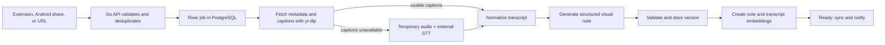

# Visual YouTube Notes — Feature Specification

**Status:** Validated product direction  
**Audience:** Product owner and implementing engineer  
**Scope:** Personal, self-hosted V1 plus a defined V1.1 extension  
**Last updated:** 2026-09-04

### Requirement language and time

Unless a requirement is explicitly labeled V1.1, out of scope, **SHOULD**, or **MAY**, sections 5–16 describe required V1 behavior. **MUST** is a release obligation, **SHOULD** is a target that may be waived with a documented reason, and **MAY** is optional. The acceptance checklist is a minimum executable test set, not a substitute for the other V1 requirements.

Server time is stored in UTC. User-facing dates, Trash expiry, session inactivity, budgets, and schedules use an account timezone setting that defaults to `Asia/Kolkata`.

## 1. Product definition

### North-star promise

> Save any public YouTube video from desktop or Android, and receive a synchronized, searchable visual learning note—diagram first, concise bullets, no paragraph-heavy reading.

The product turns deliberately saved YouTube videos into tablet-friendly learning artifacts. It is a memory and review tool after watching, not a replacement for watching and not a duplicate of YouTube history.

### Primary user

The V1 user is the product owner. There is one account, no public registration, and no collaboration. The data model must still include `user_id` so multi-user support can be added later without a major migration.

### Product principles

1. Saving must take one intentional action.
2. The first useful content should be visual, concise, and scannable.
3. Generated content must stay faithful to the source video; opinions and unsupported assertions are represented as the speaker's claims.
4. The personal **My takeaway** block must never be overwritten by AI. Manual edits to generated sections may be replaced by regeneration, but remain recoverable in revision history.
5. AI cost must be visible and controllable.
6. The V1 must be useful without multimodal video analysis.

## 2. Goals and success measures

### V1 goals

- Save a YouTube video from a Chromium browser, Android's share sheet, or a manual URL field.
- Generate a structured visual note from captions or speech-to-text.
- Sync notes to a responsive, installable PWA optimized for an Android tablet.
- Browse learning activity by save date, then by topic.
- Find prior learning through combined semantic and keyword search.
- Correct, regenerate, version, export, and delete notes safely.
- Run the app on the owner's OCI server with AI usage as the main variable cost.

### Success measures

The backend records these private product events locally; there is no rating UI or third-party analytics requirement.

- **First-pass usefulness proxy:** over a rolling 30-day cohort with at least 20 ready notes, at least 80% receive no regeneration event during the seven days after first becoming ready. Manual edits do not make a note unsuccessful.
- **Processing reliability:** over a rolling 30-day cohort with at least 20 eligible submissions, at least 95% reach `ready` within 24 hours. The denominator excludes user cancellation and sources rejected by the eligibility rules in section 8.1, but includes worker/provider failures after eligibility is established.
- **Revisit behavior:** at least three distinct notes per calendar week are opened from Search or Topics more than 24 hours after their save time.

### Usage envelope

- Up to five saved videos per day.
- Typical duration: 30 minutes.
- Maximum supported duration: two hours.
- Supported input languages: English, Hindi, and Hinglish.
- Generated note language: English.

## 3. Milestones

### V1 — transcript-derived visual notes

V1 is complete and useful on its own. It includes capture, caption/STT ingestion, structured visual notes, editing, date/topic organization, search, sync, offline reading, notifications, export, authentication, administration, and cost controls.

### V1.1 — optional visual video analysis

V1.1 adds a user-triggered **Enhance with visual analysis** action. It analyzes frames, slides, charts, and demonstrations, then produces a new note version. It is never automatic.

V1.1 also adds switching among compatible diagram types. Screenshots from videos are neither displayed nor retained after processing.

## 4. Explicitly out of scope for V1

- Automatic watch-history capture or a watched-but-not-saved inbox
- Sources other than YouTube
- Native Android application
- Private, members-only, paid, or age-restricted videos
- Videos longer than two hours
- Public signup or multiple active users
- AI chat or “ask my library”
- Web fact-checking
- Timestamp links
- Freehand drawing or a general-purpose canvas
- Multimodal video/frame analysis
- User-selectable diagram type
- Notion, Obsidian, OneNote, or other note-app integrations
- Firefox and Safari extensions
- Collaboration, social sharing, quizzes, and flashcards
- Thumbs-up/down or other output-rating systems
- Manual transcript upload/paste

## 5. Core user journeys

### 5.1 Save from desktop YouTube

1. The user watches or opens a public YouTube video in Chrome, Edge, or Brave.
2. The user clicks **Create visual notes** on the YouTube page or in the extension toolbar.
3. The extension submits the canonical video ID and URL using its paired device session.
4. The backend deduplicates by YouTube video ID.
5. A new submission shows **Added** with a five-second Undo action. The River job is committed immediately but scheduled five seconds in the future, so Undo can remove it before external work begins.
6. The PWA shows live processing status and sends an optional push notification when ready or failed.
7. Saving a duplicate opens the existing note and offers regeneration; it never creates a second note.

### 5.2 Save from Android

1. The user installs the PWA through Chrome so Android registers it as a WebAPK share target.
2. In the YouTube app, the user selects **Share → Visual Notes**.
3. The PWA share handler looks for a supported URL in `url`, then `text`, then `title`. Android usually places URLs in `text`. It uses the first valid YouTube video URL and ignores unrelated text; if more than one valid video URL is present, it asks the user to select one.
4. If offline, the link is placed in IndexedDB and submitted when connectivity returns.
5. If authentication has expired, the shared URL remains pending while the user signs in.
6. Onboarding includes a share-integration test. If Chrome installation on the target tablet does not produce a working WebAPK share target, a signed thin Trusted Web Activity APK using the same PWA is the required V1 fallback. This compatibility wrapper does not introduce a separate native UI and is exempt from the “native Android application” exclusion.

### 5.3 Save manually

The PWA exposes **Add YouTube link** as a universal fallback. Submission behavior, deduplication, validation, and processing are identical to extension and Android shares.

### 5.4 Review and edit

1. The user opens Today or a prior date.
2. A note card shows title, channel, duration, primary topic, save time, processing state, and a two-line summary. Cards do not show thumbnails.
3. The note opens with the visual hierarchy defined in section 7.
4. The user may edit the summary, key points, important details, and practical actions; add, delete, and reorder list items; rename/delete diagram elements; adjust supported diagram layout/order; edit topics/tags; and write a personal takeaway. Source metadata and the transcript are read-only in V1.
5. Edits to generated content autosave and sync. Personal takeaways are stored separately from generated revisions.

### 5.5 Regenerate

1. The user requests regeneration and may add a short instruction such as “simplify this.”
2. Regeneration starts from the retained transcript and instruction, not from manually edited generated text.
3. The job records the active revision as its regeneration base and creates a new generated revision. It activates the result only if the note still points to that base revision. If a manual edit became active meanwhile, the generated revision remains available and the user is asked whether to activate it.
4. The prior active revision—including manual edits—remains restorable.
5. The personal **My takeaway** block is preserved unchanged.

### 5.6 Search

1. The user enters a natural-language phrase or exact keywords.
2. PostgreSQL full-text results and `pgvector` similarity results are combined and ranked.
3. Search covers titles, channels, summaries, bullets, diagram text, topics, tags, personal takeaways, and hidden transcript chunks.
4. Filters include date range, primary topic, channel, and video duration.
5. A transcript-only match returns the parent note card with a short highlighted excerpt. It does not expose a long transcript by default.

## 6. Information architecture

The PWA has six top-level destinations:

1. **Today** — date-first learning activity and processing cards
2. **Library/Search** — universal search, filters, and all notes
3. **Topics** — primary-topic browsing and tag discovery
4. **Note detail/editor** — visual note, source, editing, versions, and export
5. **Settings** — account, sessions, AI providers/models, usage, cost limits, notifications, and backups
6. **Trash** — recoverable deleted notes

Processing status appears in Today and note cards rather than a separate jobs screen.

## 7. Note specification

### 7.1 Note-detail hierarchy

1. Title, channel, duration, save date/time, publication date, and YouTube link
2. One-sentence summary
3. Main visual diagram
4. Five to seven key bullet points
5. Important details
6. **What I can use**, included only for advice, steps, or decisions
7. User-owned **My takeaway**
8. Collapsed source transcript and version history

Notes may scroll. The first viewport should be compact when possible, but fitting everything on one screen is not a hard requirement.

### 7.2 Diagram behavior

The note generator chooses exactly one diagram type:

- Mind map — default and general fallback
- Process flow — ordered procedures or causal sequences
- Timeline — chronological development
- Comparison matrix — alternatives, trade-offs, or categories

The canonical diagram is structured JSON, not a generated bitmap. Every diagram has `schema_version`, `type`, stable element IDs, element-level `source_refs`, and a type-specific body:

```text
mind_map | process_flow:
  nodes[{id, label, kind, group_id?, provenance, source_refs[]}]
  edges[{id, from, to, label?, order?, provenance?, source_refs[]?}]
  layout{engine, direction?}   # coordinates live outside the revision

timeline:
  events[{id, label, order, group_id?, provenance, source_refs[]}]

comparison:
  columns[{id, label, provenance, source_refs[]}]
  rows[{id, label, provenance, source_refs[], cells{column_id: {text, provenance, source_refs[]}}}]
```

`source_refs` point to transcript chunk IDs and character spans; they are internal grounding data and are not timestamp links. Every content-bearing element has `provenance: ai | user_edited`. AI-authored text requires source references. Structural edges without labels may omit them; AI-authored edge labels and comparison headers require them. Editing AI text changes provenance to `user_edited` and clears its source references rather than retaining misleading grounding. A separate JSON Schema file in the implementation repository is the normative validation artifact and is versioned with database migrations.

All diagram text is selectable and searchable. Mind maps and process flows support touch pan/zoom, automatic layout, and persisted positions. Timelines support ordered event editing; comparisons support row order and cell editing. Deleting a graph node deletes incident edges after confirmation. V1 does not support adding graph nodes/edges or changing diagram type.

Hard limits are 12 initially visible content elements, 24 total elements including collapsed groups, and a comparison matrix of at most four columns by six rows. Comparison headers do not count toward the 12-element graph/timeline limit. Overflow is grouped into collapsed branches. The structured text alternative exposes the same hierarchy/relationships without relying on canvas position.

The UI uses a clean digital style with subtle notebook character, not simulated handwriting. It supports system light/dark theme, portrait and landscape, with the note viewer optimized for tablet landscape.

### 7.3 Grounding and generated schema

The note-generation model must return schema-valid structured output containing:

- `summary` (one content block, maximum 40 words)
- `diagram` matching exactly one type-specific body from section 7.2: graph `nodes/edges`, timeline `events`, or comparison `columns/rows`
- `key_points[]` (five to seven content blocks)
- `important_details[]` (three to eight content blocks)
- optional `practical_actions[]` (zero to five content blocks)
- `primary_topic`
- `tags[]`
- detected source language
- `source_refs[]` on every AI-authored content block and content-bearing diagram element

Each content block contains a stable ID, text, provenance, optional `speaker_claim: true`, and source references when AI-authored. Every V1 AI-generated claim must be traceable to the stored transcript; user-edited content is visibly user-owned and is exempt from source grounding. The product summarizes what the speaker says; it does not independently validate external truth. Invalid model output is repaired automatically or retried before the job is marked failed.

`practical_actions` is empty unless the transcript contains an explicit recommendation, procedure step, task, or decision rule. The model may condense such material but must not invent actions from purely descriptive content.

### 7.4 Metadata

Each note stores:

- Internal note ID and `user_id`
- YouTube video ID and canonical URL
- Video title and channel
- Duration
- Publication date
- Save date/time, used for the daily timeline
- Detected language
- Caption/transcript source
- Processing state and failure stage
- Primary topic and tags
- Models/providers used by processing role
- Estimated and reported AI usage/cost
- Current version and version history
- Account timezone used for display/grouping

Thumbnails are not stored. The original publication date is informational only; save date/time controls the learning timeline.

### 7.5 Topics

Each note must have one primary topic for clean browsing and may have multiple cross-cutting tags. The generator proposes both. Topics are global normalized entities owned by the user. The user may rename or merge a topic and move a note, but cannot leave a non-Trash note without a primary topic. Tags may be freely added or removed.

## 8. V1 processing pipeline



### 8.1 Submission and validation

- Accept `youtube.com`, `m.youtube.com`, and `youtu.be` URLs and normalize them to a canonical video ID. For playlist URLs containing a `v` parameter, process only that video and ignore the playlist.
- Eligible sources are public standard videos, Shorts, and completed public livestreams/premieres that are no longer live, require no account cookies, are reachable from the server region, and are no longer than two hours.
- Reject malformed/non-YouTube URLs, active livestreams, scheduled premieres, region-blocked sources, bot/cookie/login challenges, restricted sources, and over-two-hour videos with a clear reason.
- Enforce one note per user/video ID.
- Create the note and River job transactionally.
- Duplicate behavior depends on state: `processing` opens status; `ready` opens the note with Regenerate available; `failed` opens Retry/Delete; `Trash` asks to restore. A duplicate does not change save time. After permanent purge, saving creates a new note.

### 8.2 Metadata, captions, and transcription

1. Invoke the maintained `yt-dlp` CLI from the Go worker; do not add a Python/FastAPI service.
2. Fetch metadata and select captions in this order: human English/Hindi, automatic English/Hindi, then another track detected as supported Hinglish.
3. Captions are usable when parsing succeeds, the detected language is supported, normalized text contains at least `max(30, 10 × video_minutes)` words, and repeated-line content is below 40%. Extraction/network failure is retryable; a confirmed missing or unusable track triggers STT.
4. If captions are absent or unusable, download audio only to a unique temporary directory.
5. Prefer Opus or M4A audio without re-encoding. If a provider limit is exceeded, split with FFmpeg into at most 20-minute chunks with 15 seconds of overlap, then deterministically remove overlap after transcription.
6. Send audio chunks to the configured external transcription provider with per-attempt timeouts. Provider-specific upload limits/timeouts are validated when settings are saved.
7. Preserve the original transcript language/script and normalize only punctuation, whitespace, repeated caption lines, and chunk overlap. Translation to English happens in generated notes, not in the retained transcript.
8. Delete all temporary audio on success, failure, cancellation, or worker restart cleanup.
9. Retain the normalized transcript privately for search and regeneration. Transcript editing/correction is not part of V1.

V1 does not download video files and does not retain audio.

### 8.3 Note generation and indexing

1. Chunk the transcript without losing section boundaries.
2. Ask the configured note model for the structured schema in section 7.3.
3. Validate schema, diagram limits, grounding, and language.
4. Retry/repair invalid output.
5. Persist the generated version and searchable diagram text.
6. Embed both note sections and transcript chunks with the configured embedding model.
7. Mark the note ready and publish a live status event and optional Web Push notification.

### 8.4 Job states and retries

User-visible states are:

`queued → metadata → captions → transcribing (optional) → generating → indexing → ready`

Internal lifecycle also includes `cancelling` and `cancelled`. Undo during the five-second delay hard-deletes the pending note/job. Delete after work begins moves the note to Trash, requests cooperative cancellation, and discards late results. An already accepted external request may still finish and incur cost.

Any stage may become `failed`. Each stage receives one initial attempt plus at most three automatic retries, delayed approximately 30 seconds, two minutes, and ten minutes. Network failures, timeouts, provider 429/5xx responses, and extractor breakage are transient. Validation failures and provider 4xx responses other than 408/409/429 are permanent unless the user changes settings/input. The UI shows the exact failed stage and offers only **Retry** and **Delete**.

Manual Retry creates a new attempt, reuses stored metadata/captions/transcript, never reuses temporary media, and warns that new AI charges may occur. Persist a stage/attempt record before every external call and its response fingerprint afterward; use provider idempotency keys when available. A crash between a provider response and persistence can still cause a duplicate paid call and is recorded as an accepted at-least-once boundary.

Temporary directories are named with job and attempt IDs. Startup cleanup removes directories older than six hours only when their attempt is not active. Partial metadata/transcripts remain private for Retry and are purged with the note.

Target processing times:

- Under two minutes when usable captions exist
- Under five minutes when external STT is needed
- Under ten minutes for V1.1 visual enhancement

These are median targets for a typical 30-minute video, measured from job start to `ready` under normal provider operation. Two-hour sources have no latency target. Queue delay is reported separately.

## 9. Editing, sync, versions, and lifecycle

### Editing and conflicts

- Text and diagram edits autosave after a two-second debounce using a base revision ID and client mutation ID.
- If the base revision is stale, the server never overwrites it. It creates a conflict revision, keeps the current server revision active, and shows a compare/restore choice. Offline mutations replay in client order and are idempotent by mutation ID.
- Reindex affected content after edits.
- Store the personal takeaway outside AI-generated version payloads.

### Version history

- Every AI generation, manual autosave batch, conflict, and restore creates an immutable `note_revision`; the note stores only an `active_revision_id` pointer.
- Revision origin is `generated`, `manual`, `conflict`, or `restore` and records its parent revision.
- The user can preview any revision and restore it by creating a new `restore` revision.
- Because V1 is single-user and low-volume, versions are retained until the note is permanently deleted.
- Only one regeneration job may hold a note's generation lock. Activation uses the base-revision compare-and-set rule in section 5.5, so generation never silently replaces a newer edit.

### Offline behavior

- Cache the last seven days of the daily feed and previously opened notes for at most 30 days. Do not cache full transcripts unless the user explicitly opens one.
- Queue edits and shared/manual URLs in IndexedDB and sync when online.
- Resolve conflicts as described above.
- AI processing always requires the server and internet.
- Local sign-out immediately clears cached notes, queued mutations, and tokens. When an online device foregrounds the PWA, it must validate/refresh the session before revealing cached notes; a rejected session clears the cache. An offline device may retain access until its next online foreground check, which is an accepted technical limitation.

### Deletion

- Delete moves a note to Trash for 30 days.
- Restore returns it to its original save date/topic.
- Automatic live-data purge removes the note, all revisions, transcript, embeddings, and related job data.
- If a source video later disappears, keep the note and transcript without adding an availability marker.

## 10. Search requirements

- Search only the active revision of `ready` notes. Exclude processing, failed, old revisions, and Trash.
- Use PostgreSQL full-text search with the `simple` configuration for Unicode/English-Hindi-Hinglish lexical matching. Weight title/topic/tags highest, then summary/key points/diagram/takeaway, then details/actions, then transcript.
- Use `pgvector` cosine similarity for semantic matching.
- Treat every indexed note section or transcript chunk as a child candidate. Fuse each child's lexical and semantic ranks with `child_score = 1/(60 + lexical_rank) + 1/(60 + semantic_rank)`, using zero for a missing rank.
- Aggregate children to a note before pagination with `note_score = best_child_score + 0.25 × second_best_child_score`; deduplicate by note ID and break ties by newer save time, then ascending note ID. Return 25 notes per cursor page.
- Chunk transcripts near 500 embedding-model tokens with 75-token overlap, preferring caption/sentence boundaries. Embed note sections separately.
- Parent every transcript match to its note.
- Apply date/topic/channel/duration filters before ranking. Date boundaries use the account timezone.
- A transcript-only excerpt is at most 240 characters. Lexical results center on the match; semantic-only results use the best matching sentence. Show at most two transcript excerpts per note.
- Update embeddings after regeneration and relevant manual edits.
- If the embedding model changes, expose an admin reindex operation and never mix incompatible vector dimensions/indexes.
- Search returns notes and excerpts only. It never synthesizes an answer.
- If query embedding fails or times out, return keyword results with a visible semantic-search warning rather than failing the whole search.

## 11. Authentication and administration

### Account and sessions

- Disable public signup and seed one owner account.
- Hash the password with Argon2id and an appropriate per-password salt.
- Issue opaque random 256-bit access and refresh tokens; store only keyed hashes server-side. Access tokens last 15 minutes. Refresh tokens rotate atomically and expire after 30 days without a successful refresh; active sessions have no separate absolute lifetime.
- Trusted PWA and extension devices follow the same 30-day inactivity rule.
- Store refresh-token hashes, not raw tokens, and track device sessions independently.
- Settings lists active sessions and supports single-device revocation and **Sign out all devices**.
- The PWA receives both tokens in `Secure`, `HttpOnly`, same-origin cookies with `SameSite=Lax`; refresh cookies are scoped to `/auth/refresh`. The server supplies a non-secret, session-bound CSRF token for state-changing requests and validates both it and the request origin.
- PWA API traffic is same-origin. CORS denies arbitrary origins but explicitly allows the signed/allowlisted Chromium extension origin on its required pairing, token, and submission endpoints.
- The extension stores its own paired token set in non-synced extension-local storage and sends the access token as a bearer credential only to the configured app origin.
- Revocation immediately invalidates both access and refresh tokens for that device. Refresh-token reuse atomically revokes that token family only and records a security event.
- Bootstrap and password recovery use an authenticated server CLI (`create-owner`, `reset-password`); there is no email recovery. Password change revokes all other sessions.

### Extension pairing

1. The allowlisted extension generates a 256-bit random verifier locally and sends its SHA-256 challenge plus its extension ID to create a pairing request. The server stores the challenge hash, extension ID, expiry, approval state, and a public request ID; it expires in five minutes.
2. The extension opens the authenticated pairing page in the PWA with the public request ID.
3. The user approves the named browser/device.
4. The extension sends the original verifier directly to the exchange endpoint. The server hashes it, compares it in constant time, verifies the extension origin/approval/expiry, and atomically consumes the request while issuing a device-specific token family. Replay and mismatched origins are rejected.
5. The password is never entered or stored in the extension.

### AI configuration

An admin-only Settings page configures four independent processing roles:

1. Transcription
2. Note generation
3. Embeddings
4. Visual analysis (inactive until V1.1)

For each role, store provider, model identifier, endpoint where applicable, and API key. Model identifiers are runtime configuration rather than hard-coded product assumptions. Preferred models may be selected when their APIs are actually available.

- Encrypt API keys at rest with an application master key supplied to the server as a mounted secret file rather than an environment variable, because the worker continuously spawns child processes that would inherit it. The file holds versioned keys so the current and previous key can both be loaded during a rotation.
- Retry the configured model, but never silently switch providers.
- Show monthly aggregate usage in Settings and per-note cost in note metadata.
- Default to a configurable $10 monthly soft cap covering all AI roles, including regeneration and query embeddings. The calendar month follows the account timezone.
- Check the estimated charge at the first point it can be computed and before any paid call: after the free metadata and caption stages for a new submission, or at submission for a regeneration or a retry that already holds a transcript. In-flight work finishes and counts toward the current month. At the cap, each run requires one explicit cost confirmation before its first paid call; a held submission notifies the owner and waits, and is never resumed automatically. V1.1 visual enhancement is disabled first.
- At the cap, semantic query embeddings pause and Search visibly falls back to keyword results until the user raises the cap or explicitly re-enables semantic search for the month.
- Keep versioned per-model price settings because providers may report tokens/seconds without monetary cost. Changing a price never rewrites historical estimates.

## 12. Export and backup

### Note exports

- Export one note as PDF or Markdown.
- Include the visual note and source metadata by default.
- Offer an **Include transcript** toggle.
- Render diagrams as vector graphics in PDF. Markdown export is a ZIP containing UTF-8 Markdown with no remote references: a mind map or process flow ships a local SVG asset beside the Markdown, while a timeline becomes a numbered list and a comparison matrix a Markdown table.

### Library backup

- Export a versioned JSON archive containing notes, transcripts, metadata, topics/tags, revisions, personal takeaways, and checksums. Exclude passwords, sessions, encryption keys, and provider secrets. Import is not required in V1; database restore remains the disaster-recovery path.
- Run encrypted PostgreSQL backups daily.
- Retain seven daily copies locally.
- Copy an encrypted weekly backup to the owner's laptop or another existing off-server location and retain four weekly copies.
- Document and test restoration; a backup is not complete until restore succeeds.
- Live-data purge does not rewrite existing encrypted backups. Purged content may therefore remain encrypted for at most four additional weeks before backup expiry; this is the documented deletion window.
- Back up the application master key separately from the database, encrypted under an owner-held recovery secret. Test a restore quarterly, including key recovery.

## 13. Technical architecture

### Frontend

- Svelte 5 + SvelteKit + TypeScript
- Static/installable PWA with manifest, service worker, IndexedDB offline queue, Web Push, and `share_target`
- Responsive tablet-first interface; landscape-optimized note canvas
- API-generated OpenAPI client or shared generated types where practical

### Backend

- Go REST API
- Separate Go worker process
- PostgreSQL with `pgvector`
- River for transactionally enqueued PostgreSQL-backed jobs
- Server-Sent Events for one-way live job-state updates; polling fallback
- `yt-dlp` and FFmpeg installed only in the worker image

### Deployment

Docker Compose services:

- Caddy for TLS, static PWA delivery, and reverse proxy
- Go API
- Go worker
- PostgreSQL with `pgvector`
- One-shot migration jobs that gate the API and worker: one for the job-queue schema, which the queue library owns, and one for the application schema
- Headless Chromium (Gotenberg) for PDF rendering, kept out of the worker image
- Backup job/container

The OCI host provides 4 vCPU and 24 GB RAM. Default worker concurrency should be conservative and configurable so downloads, FFmpeg, and indexing do not starve PostgreSQL or the API.

Start with two concurrent general jobs and run FFmpeg/STT preparation on a single-worker queue so it is always serialized; before media preparation begins, check free space on the temporary volume and fail the stage clearly below a configured floor. Compose uses explicit persistent volumes, health checks, restart policies, migration jobs, disk-usage alerts, and bounded structured-log retention. Deployment documentation includes forward migration, rollback procedure, stuck-job inspection, backup-failure alerting, and `yt-dlp` update/rollback.

### Recommended resource/API boundaries

- `/auth/*` — login, refresh, logout, account, sessions
- `/pairing/*` — extension pairing, extension token refresh and logout, and revocation
- `/submissions` — create/undo/deduplicate YouTube submissions
- `/notes/*` — list, read, edit, regenerate, versions, restore, trash
- `/search` — hybrid search and filters
- `/topics/*` — primary topics
- `/tags/*` — tags
- `/exports/*` — note and library exports
- `/settings/*` — AI roles, usage, cost cap, notifications
- `/events` — authenticated SSE stream
- `/push-subscriptions` — Web Push device registration

## 14. V1.1 visual enhancement

The note-detail action **Enhance with visual analysis**:

1. Shows an estimated incremental cost and requires confirmation.
2. Sends the public YouTube URL directly to the configured video-capable provider when supported.
3. If the provider requires a file, downloads a temporary low-resolution video with `yt-dlp`, uploads it, and deletes it on every exit path.
4. Extracts visual evidence from slides, charts, formulas, interfaces, and demonstrations.
5. Stores compact visual-evidence records containing provider description, internal time span, and provider/file reference where available; it never retains image frames.
6. Starts from the transcript plus the current active revision, creates a new generated revision combining transcript and visual evidence, and preserves the prior revision and personal takeaway. Manual edits remain in history but may be replaced in the new active revision.
7. Links V1.1 claims to transcript references, visual-evidence references, or both. The V1 transcript-only grounding rule becomes a source-evidence grounding rule for V1.1.
8. Does not display or retain screenshots. Provider-side uploaded files are deleted through the provider API when supported; provider retention remains governed by the configured provider.

V1.1 enhancement uses the same generation lock and base-revision compare-and-set rule as V1 regeneration. Edits made during a generation job create a newer manual revision; completion never silently overwrites it and instead asks the user whether to activate the generated revision.

V1.1 permits local switching only between mind map and process flow when all elements map to nodes/edges. Timeline or comparison conversions require regeneration.

## 15. Non-functional requirements

### Reliability

- Submission and job creation are atomic.
- All jobs are idempotent by note/video and processing version.
- A worker restart cannot lose a committed job.
- Automatic retries distinguish three kinds of failure: transient provider/network failures, which retry; permanent input failures, which wait for the user; and extractor breakage, which is permanent under the current pinned tool version, clears when that pin moves, and alerts the owner rather than blaming the video.
- Temporary-file cleanup runs both per job and during worker startup.
- API create/update/delete events carry monotonically increasing sync cursors. SSE publishes them; clients resync from the last cursor after reconnect, and polling uses the same cursor endpoint.
- Pipeline progress is published on the same stream as uncursored, best-effort frames a client may miss. Only terminal processing states are recorded as cursored events, so a dropped progress frame heals on the next one and a dropped terminal state cannot happen.

### Performance

- A successful submission appears in Today within three seconds.
- Today and note-detail cached content should become interactive within two seconds on a typical tablet connection.
- Search should return the first page within one second at the expected personal-library scale, excluding query-embedding provider latency.
- Diagram pan, zoom, and node movement should remain responsive on the target Android tablet.

### Security

- HTTPS only, secure headers, strict input validation, and rate limits on authentication and job creation.
- Do not log passwords, refresh tokens, provider keys, transcript bodies, or shared query parameters.
- Encrypt provider keys at rest and keep the encryption master key outside PostgreSQL.
- Restrict worker subprocess arguments and temporary paths; never interpolate raw URLs into a shell command.
- Scan/update `yt-dlp` deliberately because upstream YouTube changes may break extraction.

### Accessibility and usability

- Touch targets of at least 44 CSS pixels.
- Keyboard navigation for desktop use.
- Sufficient light/dark contrast and no color-only job states.
- Diagram has a structured text alternative matching its nodes and relationships.
- Processing and error language identifies the next available action.

## 16. Acceptance criteria

V1 is done when all of the following pass on the production-like OCI deployment:

### Capture

- Chrome, Edge, and Brave can create a note through the Manifest V3 extension's in-page and toolbar actions.
- On the target tablet, either the Chrome-installed WebAPK or the required TWA fallback appears in YouTube's share sheet and successfully receives URLs supplied in Android's text field.
- The manual URL field accepts all supported YouTube URL forms.
- Duplicate submission opens the existing note and does not create another row/job.
- Unsupported or restricted sources fail clearly before incurring avoidable AI cost.

### Processing

- A captioned English, Hindi, and Hinglish video follows the caption path without STT.
- A video without usable captions follows the temporary-audio STT path.
- Temporary media is absent after success, failure, cancellation, and simulated worker restart.
- Generated output conforms to the note schema and diagram limits.
- A transient provider failure retries; a permanent failure exposes Retry and Delete.

### Notes and lifecycle

- Each completed note displays the agreed hierarchy, editable structured diagram, bullets, optional practical actions, and personal takeaway.
- Regeneration creates a restorable version and preserves the personal takeaway.
- Trash restores within 30 days and permanent purge removes dependent data.
- PDF, Markdown, and full JSON exports contain the expected content, including transcript toggles.

### Organization and search

- Today groups notes by save date/time and cards contain the required fields without thumbnails.
- Notes browse under one primary topic and multiple editable tags.
- Exact keyword and semantic queries return relevant note sections.
- A transcript-only match shows a short excerpt attached to the parent note.
- Date, topic, channel, and duration filters compose correctly.

### Sync, offline, and account

- A desktop submission appears on the tablet without manual refresh.
- Previously opened notes remain readable offline.
- Offline edits and a shared URL sync when connectivity returns without silent loss.
- Access-token refresh maintains a trusted 30-day session; rotating refresh reuse is rejected.
- The user can revoke one session or all sessions, including the extension.
- Push notifications can be enabled/disabled and occur only when a job reaches a state that waits for the user: ready, failed, or held at the cost cap. Intermediate pipeline stages never notify. Note notifications and operational alerts can be enabled independently.

### Cost and operations

- Per-note and monthly AI usage are visible.
- The monthly soft cap changes behavior as specified.
- Daily encrypted backup, weekly off-server copy, and documented restore test succeed.

### Cross-cutting contract

- Every generated content block and diagram element validates against the versioned schema and has valid source references; speaker claims render distinctly.
- An edit conflict on two devices creates a recoverable conflict revision without data loss.
- Killing SSE proves cursor-based polling/resynchronization still creates, updates, and deletes notes across devices.
- Provider keys are encrypted at rest, raw secrets/tokens/transcripts are absent from logs, and silent provider failover does not occur.
- Changing the embedding model blocks mixed-index search and the admin reindex completes before the new index becomes active.
- Remote session revocation blocks further sync; local sign-out clears offline data.
- Keyboard/touch navigation, diagram text alternatives, contrast, and the stated performance targets pass on the target tablet/browser set.
- Every requirement in sections 5–16 is reviewed before release even when it is not repeated in this checklist.

## 17. Known risks and accepted constraints

1. **YouTube extraction:** V1 deliberately uses `yt-dlp` for captions and temporary audio. This is technically practical but unofficial, may break when YouTube changes, and may conflict with YouTube terms or content-owner expectations. The owner accepts this for a personal self-hosted tool; distribution would require a fresh legal/platform review.
2. **Android sharing:** Web Share Target depends on an installed Chrome WebAPK. Onboarding must verify it on the actual tablet; a signed thin TWA package is the required fallback if that test fails.
3. **AI grounding:** A transcript-based generator can omit nuance or misstate relationships. Structured validation, source-grounded prompts, regeneration, and manual edits mitigate but do not eliminate this.
4. **Caption quality:** Auto-captions and Hinglish transcription may be noisy. The fallback and model configuration must be testable independently.
5. **Cost estimates:** Providers expose different usage details and may change prices. Store reported usage and versioned price configuration; label estimates as estimates.
6. **Provider/model availability:** Do not hard-code unreleased or transient model names. The admin selects available APIs at deployment time.
7. **At-least-once provider calls:** A crash after an external provider succeeds but before the result commits can repeat a call and charge. Persisted attempts, response fingerprints, and provider idempotency reduce but cannot eliminate this boundary.
8. **Offline revocation:** A server cannot remotely erase cached notes from a device that stays offline. The cache clears on local sign-out or the next online PWA foreground/session check after revocation or expiry.
9. **Backup deletion lag:** Purged live data may remain in encrypted rotating backups for up to four additional weeks.

## 18. Final decision log

- Intentional saves only; no watch history.
- Dedicated tablet-friendly app delivered as a PWA.
- Transcript-derived visual artifacts are the core; full video analysis is V1.1.
- Date-first organization uses save time; publication date is stored only as metadata.
- One primary topic plus multiple tags.
- Search finds notes; it does not answer questions.
- Hidden transcripts are retained and searchable.
- Svelte frontend, Go backend/worker, PostgreSQL/pgvector, River queue.
- Password sessions rather than Google sign-in.
- Personal-first, single-user deployment on OCI.
